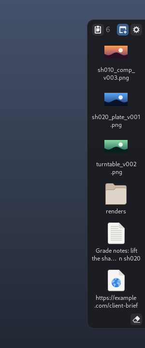
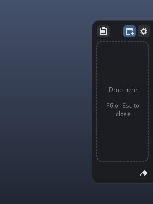
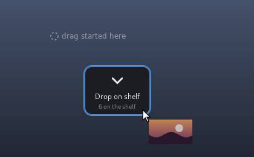
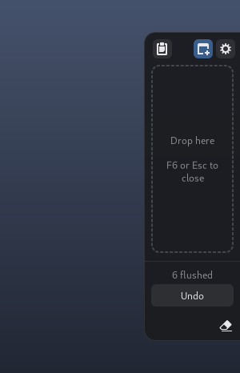
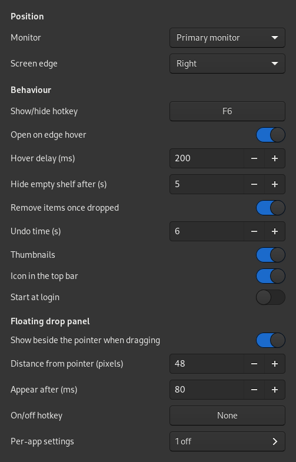
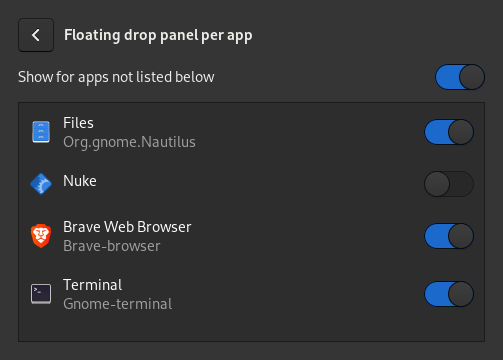

# Shelf

A drop shelf for the edge of the screen (GNOME on X11). Park files,
folders, links and text snippets on it, then drag them on to wherever they need
to go.

<p>
  
  &nbsp;
  
</p>

Needs only what Rocky/RHEL 9 already ships: Python 3, PyGObject with GTK 3, libX11
and libXfixes.

## Running

```bash
~/Documents/DEV/shelf/bin/shelf &
```

| Command | What it does |
|---|---|
| `shelf --toggle` | Show/hide the empty shelf (same as the hotkey) |
| `shelf --flush` | Take everything off the shelf |
| `shelf --add PATH` | Put a file or folder on the shelf (repeatable) |
| `shelf --add-text TEXT` | Put a text snippet on the shelf (repeatable) |
| `shelf --add-clipboard` | Put what is on the clipboard on the shelf |
| `shelf --toggle-float` | Turn the floating drop panel on or off |
| `shelf --settings` | Open the settings window |
| `shelf --app-settings` | Open the per-app settings of the floating drop panel |
| `shelf --quit` | Stop the shelf |

### As an AppImage

```bash
./packaging/build-appimage.sh
```

This makes `dist/Rocky Linux 9/Shelf-<version>-x86_64.AppImage`, a single file you can copy
anywhere (e.g. `~/Applications`) and start by double-clicking or running it. It
takes the same options as `shelf` (`--toggle`, `--settings`, ...).

The AppImage holds only the shelf itself and uses the computer's own Python 3 and
GTK 3, so it stays small. That works out of the box on Rocky/RHEL/Fedora GNOME; on
other systems it may need `python3-gobject` (or `python3-gi` and
`gir1.2-gtk-3.0` on Debian/Ubuntu). It tells you if they're missing.

Building needs `appimagetool` in `tools/` (from
[github.com/AppImage/appimagetool](https://github.com/AppImage/appimagetool/releases)),
or its path in `$APPIMAGETOOL`. Switch on *Start at Login* from the AppImage
itself, so the login entry points at the AppImage file.

## How it behaves

The shelf sits against the screen edge. Items show a thumbnail (or their icon)
with the name underneath. The header holds the **paste** button (top left), the
item count and the buttons for the floating drop panel and **Settings**; **Flush**
sits in the bottom-right corner.

- **F6** opens the empty shelf; F6 or Esc closes it again.
- The **paste** button puts the clipboard on the shelf: files copied in Files
  (kept by reference; even "cut" never moves them), a copied picture (saved as
  a PNG, like browser pictures) or text. Also in the top-bar menu, and as
  `shelf --add-clipboard` for a keyboard shortcut of your own.
- While the shelf holds anything it stays visible, on top of other windows.
- An empty shelf that is left alone (pointer elsewhere, no drag going on) fades
  away after 5 seconds.
- Start dragging anything and a blue strip appears on the shelf's screen edge.
  Drag onto it and the shelf slides out to drop into.


- **Floating drop panel:** when you start dragging something, a small "Drop on
  shelf" target appears just below-right of where the drag began (flipped to
  stay on screen) and disappears when the drag ends. Turn it on/off with the
  window icon in the shelf header, `shelf --toggle-float`, the settings, or an
  optional hotkey of your own.
- **Per app:** right-click the window icon in the shelf header to switch the
  floating panel on/off for the apps you dragged from recently, or open
  Settings → Per-app settings. Apps appear there after the first drag from them. "Show for apps
  not listed" decides what new apps do. Rules are saved under `[apps]` in
  `shelf.ini` by the app's window class, e.g. `Nuke = off`.
- Resting the pointer on the screen edge also opens it (`open_on_hover`).
- A picture dragged out of a web browser lands on the shelf as the picture
  itself (with its real file name), not as a link: the shelf takes the image
  data the browser hands over, or downloads the picture. These copies live in
  `~/.local/share/shelf/downloads` and are cleaned up a day after they leave
  the shelf. Dragging a plain link still gives a link.
- Drag items out to drop them anywhere. Once dropped, they leave the shelf.
  Ctrl/Shift-click to select several and drag them together.
- Drag the shelf by the empty space in its header to move it: let go and it
  snaps to the nearest side of the monitor you dropped it on.


- The eraser icon (**Flush**, bottom right) empties the shelf. After a flush or drop, **Undo** stays up for a
  few seconds.
- Right-click an item: Open, Show in Folder, Copy, Remove. Double-click opens
  a file or link, or copies a snippet.
- Files are kept by reference only. The shelf never moves, renames or deletes
  them, and only offers *copy* or *link* when you drag them out.

<br clear="right">

## Top bar icon, start at login, thumbnails

- The shelf's icon in the top bar shows how many items it holds. Its menu has
  Show/Hide, Floating Drop Panel, Add Clipboard, Flush, Settings, **Start at Login** and Quit.
  Middle-click the icon to show/hide the empty shelf. (Needs the AppIndicator
  extension, which is on here; turn the icon off in Settings if you don't want it.)
- **Start at Login** (tray menu or Settings) adds or removes
  `~/.config/autostart/app.shelf.Shelf.desktop`, which starts this
  copy of the shelf when you log in.
- Images, videos, PDFs and office files get thumbnails from GNOME's own
  thumbnailers, shared with Files in `~/.cache/thumbnails`. They are made one at
  a time in the background; files over 512 MB keep a plain icon (`thumbnail_max_mb` in `shelf.ini`).
  There is no EXR thumbnailer on this system, so EXRs show a file icon.

## Settings

<p>
  
  &nbsp;
  
</p>

Click the gear icon on the shelf (or run `shelf --settings`). Changes apply
straight away, including a new hotkey: click the hotkey button and press the
combination you want.

They are saved in `~/.config/shelf/shelf.ini`, which explains every option. A few
are only there, not in the window: the panel's size (`width`, `min_items`,
`max_height_percent`), the thumbnail limit and the drop strip widths. If you edit
that file by hand, restart the shelf. The contents of the shelf are kept in
`~/.local/share/shelf/state.json`.

The monitor can be `primary`, `follow-mouse`, a connector name (`DP-2`) or
a number. Sizes are worked out from whatever monitors are connected, and the
shelf moves itself when monitors are plugged in, unplugged or change resolution.

## Tests

The README screenshots are drawn from the real widgets, off screen, with sample
files: `python3 docs/screenshots.py` regenerates `docs/images/`.

```bash
cd ~/Documents/DEV/shelf && python3 -m unittest discover -s tests -t .
```

### Manual drag checks

| From → To | Result to expect |
|---|---|
| Nautilus file → shelf | file appears with its icon/thumbnail |
| Shelf file → Nautilus folder | file copied there, item leaves the shelf |
| Shelf file → Nuke node graph | Read node created |
| Shelf file → terminal | path pasted |
| Shelf file → browser upload field | file attached |
| Selected text (browser/editor) → shelf | snippet appears |
| Shelf snippet → text field / terminal | text inserted |
| Link from browser → shelf | link item |
| Drag shelf item and let go over nothing | item stays on the shelf |
| Start dragging a file in Nautilus | floating panel appears beside it after ~0.08 s |
| Drop onto the floating panel | item goes on the shelf, shelf appears |
| Let go elsewhere / press Esc | floating panel disappears |
| Drag an item out of the shelf | no floating panel |
| Turn an app off (right-click header icon), drag from it | no floating panel; edge strip still works |
| Drag from an app turned on | floating panel appears |
